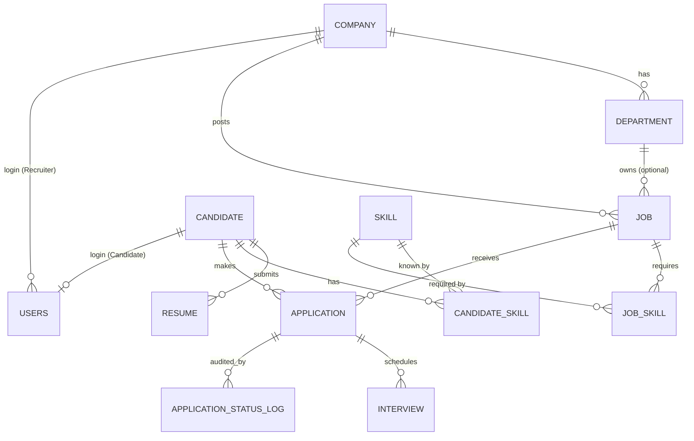

# Corporate Recruitment & Candidate Resume Indexing System
**DBMS Experiential Learning – Level 3 Project** · Team 10 · PES2UG24CS535, PES2UG24CS527

---
## 1. Objectives
1. Model the complete hiring lifecycle (company → job → application → interview → hire) in a normalised MySQL schema with integrity enforced **inside the database**.
2. Go beyond CRUD: transactional hiring, trigger-based business rules, skill-match scoring, full-text search and **semantic resume/job matching** with a vector database.
3. Provide a secure role-based Next.js web application (Admin, Recruiter, Candidate) over the database.

## 2. Functional Requirements
| ID | Requirement | Role |
|---|---|---|
| FR1 | Register / login with hashed passwords, JWT session | All |
| FR2 | Manage profile, skills, upload multiple resumes | Candidate |
| FR3 | Search jobs (full-text, location, type, salary) with skill-match % | Candidate |
| FR4 | Apply to a job (only open jobs, resume mandatory, no duplicates) | Candidate |
| FR5 | Post/close/reopen jobs with required skills | Recruiter |
| FR6 | Review applications, change status, view audit trail | Recruiter |
| FR7 | Schedule / complete / cancel interviews | Recruiter |
| FR8 | Hire a candidate atomically (reject others, close job) | Recruiter |
| FR9 | Analytics dashboard (funnel, salary, skills) | Recruiter/Admin |
| FR10 | Semantic search: recommended jobs for a resume; matching resumes for a job | Candidate / Recruiter |
| FR11 | Global visibility and job deletion | Admin |

## 3. ER Diagram
Your hand-drawn ER diagram (submitted file `10_..._ER_RS.pdf`) is the base design. During implementation the
following **refinements** were made – update the diagram/schema figure to match before final submission:

| Change | Reason |
|---|---|
| `Recruiter` entity → replaced by `Users` (Role = Recruiter, linked to `Company_ID`) | One auth table for all roles (RBAC) |
| `Candidate_Phone`, `Education`, `Experience` → simplified to `Candidate.Phone`, `Qualification`, `Experience_Years` (as in executed DDL) | Keeps schema at 3NF without multi-valued tables; matches executed DDL |
| `Job_Posting` → `Job` + `Department` (nullable `Dept_ID`) + `Posted_Date`, `Status` | Matches executed DDL; open/close lifecycle |
| **New** `Job_Skill` (M:N Job–Skill) | Enables skill-match function |
| **New** `Users`, `Application_Status_Log` | Authentication; trigger audit trail |
| `Interview` (as drawn) with `Interviewer_Name`, `Interview_Mode`, `Interview_Status`, `Feedback` | Matches ER |



## 4. Relational Schema (final, executed)
```
Company(Company_ID PK, Company_Name, Industry, Location, Email UQ)
Department(Dept_ID PK, Company_ID FK→Company, Dept_Name)            UQ(Company_ID, Dept_Name)
Job(Job_ID PK, Company_ID FK→Company, Dept_ID FK→Department NULL, Job_Title, Job_Description, Location, Salary, Job_Type, Posted_Date, Status)
Skill(Skill_ID PK, Skill_Name UQ, Skill_Category)
Job_Skill(Job_ID FK, Skill_ID FK, Is_Required)                       PK(Job_ID, Skill_ID)
Candidate(Candidate_ID PK, Candidate_Name, Email UQ, Phone UQ, Experience_Years, Qualification, Date_of_Birth)
Resume(Resume_ID PK, Candidate_ID FK→Candidate, Resume_File_Name, Resume_Text, Upload_Date)
Candidate_Skill(Candidate_ID FK, Skill_ID FK, Proficiency_Level)    PK(Candidate_ID, Skill_ID)
Application(Application_ID PK, Candidate_ID FK, Job_ID FK, Application_Date, Application_Status)  UQ(Candidate_ID, Job_ID)
Interview(Interview_ID PK, Application_ID FK, Interviewer_Name, Interview_Date, Interview_Mode, Interview_Status, Feedback)
Users(User_ID PK, Username UQ, Password_Hash, Role, Candidate_ID FK UQ NULL, Company_ID FK NULL, Created_At)
Application_Status_Log(Log_ID PK, Application_ID FK, Old_Status, New_Status, Changed_At)
```
**Normalisation:** all tables are in 3NF/BCNF – M:N relations are resolved with composite-key tables; no transitive dependencies (company data is not repeated in Job, skill names are not repeated in Candidate/Job).

## 5. Database Choice & Justification
| Data | Store | Why |
|---|---|---|
| Companies, jobs, candidates, applications, interviews, users | **MySQL** | Strongly structured, relational, needs ACID transactions (hiring), FK/CHECK/UNIQUE constraints, joins and aggregates |
| Resume text and job descriptions (unstructured, text-heavy) | **Qdrant (vector DB)** | Keyword/FULLTEXT search misses meaning ("ML engineer" vs "builds recommendation models"). Embeddings + cosine similarity retrieve *semantically* similar resumes/jobs |
| Why not MongoDB? | – | Data is highly relational; the only unstructured part needs similarity search, not flexible documents |

MySQL stays the **source of truth**; Qdrant is a derived index. Search is **hybrid**: Qdrant returns nearest IDs, MySQL filters (`Status='Open'`) and enriches (names, skills, `fn_match_percentage`).

## 6. Data Dictionary
| Table | Column | Type | Constraints / Notes |
|---|---|---|---|
| Company | Company_ID | INT | PK, AUTO_INCREMENT |
| | Company_Name | VARCHAR(100) | NOT NULL |
| | Industry / Location | VARCHAR(50) / (100) | |
| | Email | VARCHAR(100) | UNIQUE |
| Department | Dept_ID, Company_ID, Dept_Name | INT, INT, VARCHAR(80) | PK; FK ON DELETE CASCADE; UQ(Company_ID,Dept_Name) |
| Job | Job_ID | INT | PK |
| | Company_ID | INT | NOT NULL, FK→Company |
| | Dept_ID | INT | FK→Department, ON DELETE SET NULL |
| | Job_Title | VARCHAR(100) | NOT NULL |
| | Job_Description | TEXT | indexed FULLTEXT with title |
| | Salary | DECIMAL(10,2) | CHECK ≥ 0 |
| | Job_Type | VARCHAR(30) | CHECK IN (Full-time, Part-time, Contract, Internship) |
| | Posted_Date | DATE | NOT NULL DEFAULT CURRENT_DATE |
| | Status | VARCHAR(10) | CHECK IN (Open, Closed), default Open |
| Candidate | Candidate_ID | INT | PK |
| | Candidate_Name | VARCHAR(100) | NOT NULL |
| | Email / Phone | VARCHAR(100) / (15) | UNIQUE; CHK_Phone length ≥ 10 |
| | Experience_Years | DECIMAL(4,1) | DEFAULT 0, CHECK ≥ 0 |
| | Qualification, Date_of_Birth | VARCHAR(100), DATE | |
| Resume | Resume_ID, Candidate_ID | INT | PK; FK ON DELETE CASCADE |
| | Resume_File_Name | VARCHAR(150) | NOT NULL |
| | Resume_Text | TEXT | FULLTEXT; embedded into Qdrant |
| | Upload_Date | DATE | NOT NULL |
| Skill | Skill_ID, Skill_Name, Skill_Category | INT, VARCHAR(50) ×2 | PK; Skill_Name UNIQUE NOT NULL |
| Candidate_Skill | Candidate_ID, Skill_ID, Proficiency_Level | INT, INT, VARCHAR(30) | composite PK; FKs CASCADE; CHECK IN (Beginner…Expert) |
| Job_Skill | Job_ID, Skill_ID, Is_Required | INT, INT, BOOLEAN | composite PK; FKs CASCADE |
| Application | Application_ID | INT | PK |
| | Candidate_ID, Job_ID | INT | NOT NULL FKs; UQ(Candidate_ID, Job_ID) |
| | Application_Date | DATE | NOT NULL |
| | Application_Status | VARCHAR(30) | DEFAULT 'Applied'; CHECK IN (Applied, Shortlisted, Interview Scheduled, Rejected, Hired) |
| Interview | Interview_ID, Application_ID | INT | PK; FK CASCADE |
| | Interviewer_Name | VARCHAR(100) | NOT NULL |
| | Interview_Date | DATETIME | NOT NULL |
| | Interview_Mode / Status | VARCHAR(10) | CHECKs (Online/Onsite/Phone; Scheduled/Completed/Cancelled) |
| Users | User_ID, Username, Password_Hash, Role | | Username UNIQUE; bcrypt hash; CHECK Role IN (Admin, Recruiter, Candidate) |
| | Candidate_ID, Company_ID | INT NULL | FK CASCADE / SET NULL |
| Application_Status_Log | Log_ID, Application_ID, Old_Status, New_Status, Changed_At | | written only by triggers |

## 7. SQL Implementation Map (rubric items 5–7, 12)
| Requirement | Where |
|---|---|
| CREATE | `01_ddl_completed.sql`, `02_schema_extensions.sql` |
| ALTER | `01` (Date_of_Birth, CHK_Phone), `02` (Job columns/constraints, Application & Candidate_Skill CHECKs) |
| DROP | `01` (Temporary_Data), `02` (DROP INDEX idx_tmp) |
| PK / FK / constraints | all tables; ON DELETE CASCADE / SET NULL / RESTRICT chosen per relationship |
| Indexes | `idx_job_status_location`, `idx_app_job_status`, `idx_candidate_exp`, `idx_resume_cand_date`, `idx_interview_date` |
| Full-text search | `ft_job`, `ft_resume` → `MATCH … AGAINST` in `/api/jobs` and Q8 |
| Views (3) | `vw_job_summary`, `vw_candidate_profile`, `vw_interview_schedule` |
| Function | `fn_match_percentage(candidate, job)` |
| Stored procedures + **transactions** | `sp_apply_for_job`, `sp_hire_candidate` (START TRANSACTION, `FOR UPDATE` lock, EXIT HANDLER → ROLLBACK) |
| Triggers (6) | closed-job / no-resume guard, Hired-is-final, audit log (insert+update), interview-date guard, interview auto-advances status |
| DML | INSERT/UPDATE `05_seed_dml`, DELETE/UPDATE/INSERT in `06_queries` Q15, all via API |
| JOIN, GROUP BY, HAVING, ORDER BY, aggregates, subqueries | `06_queries.sql` Q1–Q11 |
| Input validation at DB level | NOT NULL, UNIQUE, CHECK, FK, triggers – see test cases |
| **Advanced SQL concepts (≥4)** | Transactions, Views, Stored procedures/functions, Triggers, Indexing, Full-text search (6 demonstrated) |

## 8. Vector Database Design (Qdrant)
| Aspect | Design |
|---|---|
| What is embedded | `Resume.Resume_Text`; `Job_Title + Job_Description` |
| Model | `Xenova/all-MiniLM-L6-v2` (sentence-transformers, 384 dim) run locally with `@xenova/transformers` – no API key |
| Preprocessing | text truncated to 2000 chars, mean pooling, L2-normalised |
| Collections | `resumes` (point id = `Resume_ID`, payload `{candidate_id, name}`), `jobs` (id = `Job_ID`, payload `{title, company_id}`) |
| Index / metric | HNSW (Qdrant default), **cosine** distance |
| Retrieval | `mode=jobs`: embed resume/query → top-10 jobs → MySQL filters `Status='Open'` and adds `fn_match_percentage`. `mode=candidates`: embed job → top-15 resumes → best score per candidate → join `vw_candidate_profile` |
| Consistency | MySQL is source of truth; new resumes/jobs are indexed on insert; `npm run index:vectors` rebuilds |

## 9. System Architecture
```
 Browser (Next.js pages, React)
        │  fetch /api/*  (JWT HttpOnly cookie)
        ▼
 Next.js middleware ── verifies JWT (jose) ── 401 / redirect to /login
        ▼
 Route Handlers (RBAC guard(role)) ──► lib/db.js ──► MySQL 8  (tables, views, procs, triggers)
        │                       └────► lib/vector.js ─► Qdrant   (resumes, jobs vectors)
        └─ secrets from .env (DB_*, JWT_SECRET, QDRANT_URL) – none hard-coded
```
Security: bcrypt (cost 10), HttpOnly+SameSite cookies, parameterised queries (no SQL injection), row-level scoping (recruiters only see their company; candidates only their own data).

## 10. Important Queries
See `database/06_queries.sql` – Q1 4-table join · Q2 GROUP BY/HAVING · Q3 aggregates · Q4 scalar subquery · Q5 NOT EXISTS · Q6 relational division · Q7 function ranking · Q8 full-text · Q9 skill demand · Q10 hiring funnel · Q11 LEFT JOIN anti-join · Q12 views · Q13 audit trail · Q14 procedures · Q15 DML in transaction · Q16 locking/isolation.

## 11. Application Screenshots  *(insert before submission)*
Login · Dashboard · Jobs (search + match %) · Apply error (closed job) · Applications (status/interview/hire) · Interviews · Candidates filter · Profile & resume upload · Semantic match (both modes) · Qdrant dashboard `http://localhost:6333/dashboard` · MySQL Workbench outputs for each script.

## 12. Test Cases
Run `database/07_test_cases.sql` and the UI steps; fill **Actual** and tick Pass.

| ID | Test | Expected | Actual | Pass |
|---|---|---|---|---|
| T1 | Candidate without name | Error 1048 NOT NULL | | |
| T2 | Duplicate candidate email | Error 1062 | | |
| T3 | Negative experience | Error 3819 CHECK | | |
| T4 | Phone < 10 chars | Error 3819 | | |
| T5 | Negative salary | Error 3819 | | |
| T6 | Invalid job type | Error 3819 | | |
| T7 | Job for non-existent company | Error 1452 FK | | |
| T8 | Same candidate applies twice | Error 1062 | | |
| T9 | Invalid application status | Error 3819 | | |
| T10 | Apply without resume | Trigger: "Upload a resume before applying" | | |
| T11 | Interview before application date | Trigger error | | |
| T12 | Delete company having jobs | Error 1451 | | |
| T13 | Hire an 'Applied' application | Error + full rollback | | |
| T14 | Apply to closed job | Trigger: "job is closed" | | |
| P1 | Schedule interview | Status → Interview Scheduled; log row added | | |
| P2 | Delete candidate | Resumes + skills cascade-deleted | | |
| P3 | Hire (UI) | Hired; others Rejected; job Closed; 3 log rows | | |
| A1 | Candidate opens `/dashboard` API | 403 Forbidden | | |
| A2 | Recruiter A updates company B application | 404 | | |
| A3 | No cookie → `/api/jobs` | 401 | | |
| A4 | Wrong password | 401 "Invalid username or password" | | |
| V1 | Semantic search "NLP recommendation" as recruiter | Diya Nair ranked first | | |
| V2 | Candidate `meera` → Recommended Jobs (empty query) | Energy Data Engineer / Clinical Data Analyst near top | | |

## 13. Conclusion
The system keeps relational data in MySQL where ACID guarantees, constraints and joins matter, and uses a vector database only for the unstructured resume/job text where semantic similarity adds real value. Business rules live in the database (constraints, triggers, procedures) so they hold regardless of the client, and the Next.js layer adds authentication, RBAC and a usable interface over them. Future work: PDF resume parsing, email notifications, pagination, and re-ranking by combining cosine similarity with skill-match score.
